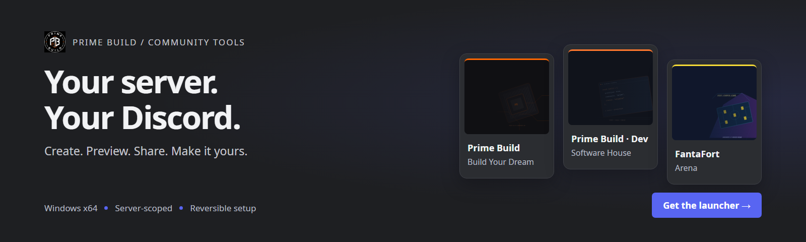
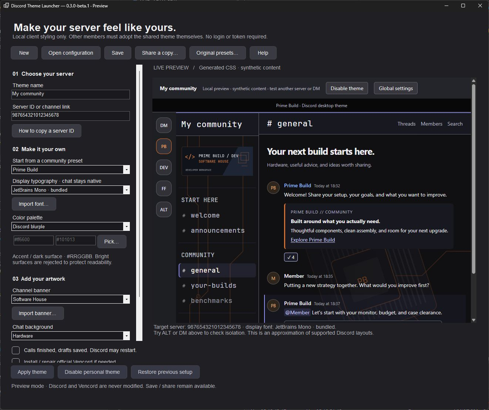
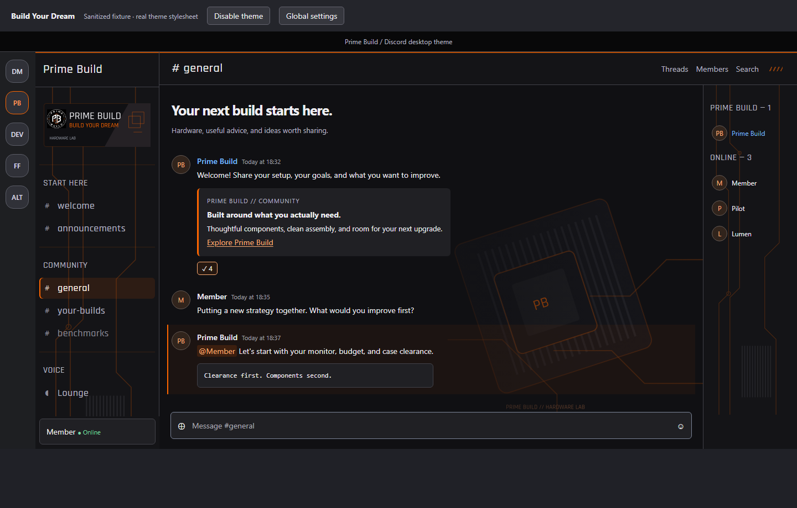
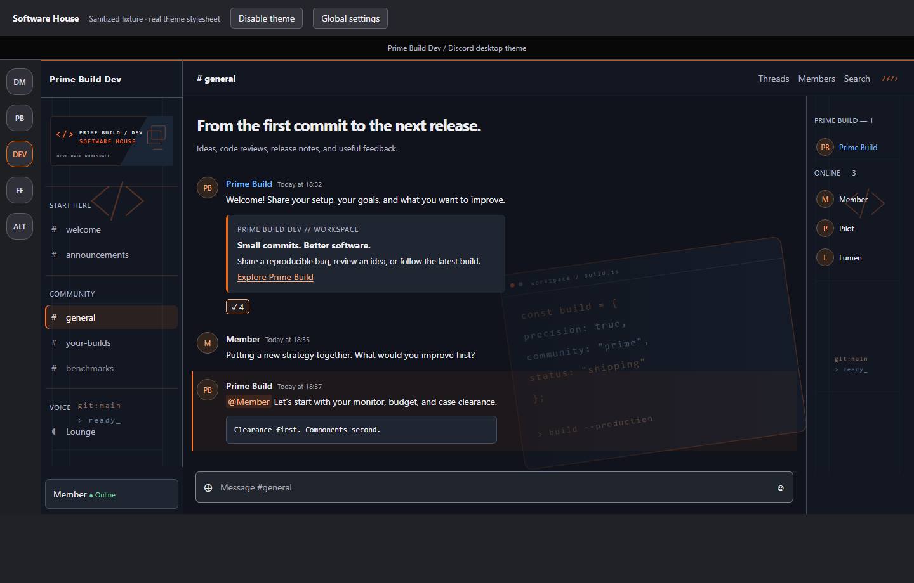
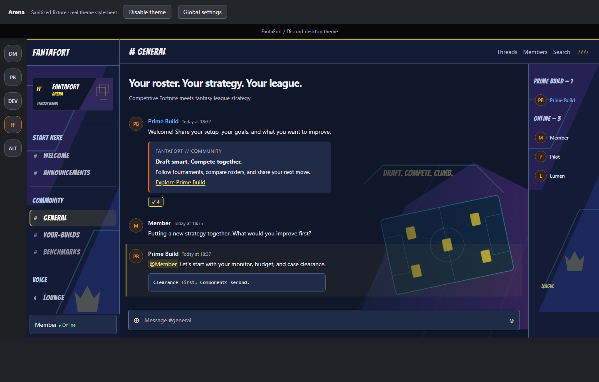

<div align="center">
  <a href="https://github.com/PrimeBuild-pc/discord-theme-launcher/releases/download/v0.3.0-beta.1/DiscordThemeLauncher-0.3.0-beta.1-windows-x64-portable.zip"></a>
  <h1>Discord Theme Launcher</h1>
  <p><strong>Make your server feel like yours.</strong><br>Create a personal theme for a Discord server you choose, starting from three community designs.</p>
  <p>
    <a href="https://github.com/PrimeBuild-pc/discord-theme-launcher/actions/workflows/check.yml"></a>
    <a href="https://github.com/PrimeBuild-pc/discord-theme-launcher/releases"></a>
    <a href="docs/COMPATIBILITY.md"></a>
    <a href="https://vencord.dev/download/"></a>
    <a href="LICENSE"></a>
  </p>
  <p><a href="https://github.com/PrimeBuild-pc/discord-theme-launcher/releases/download/v0.3.0-beta.1/DiscordThemeLauncher-0.3.0-beta.1-windows-x64-portable.zip"><strong>Download for Windows</strong></a> &nbsp;·&nbsp; <a href="#quick-setup">Quick setup</a> &nbsp;·&nbsp; <a href="docs/INSTALLATION.md">Installation &amp; recovery</a> &nbsp;·&nbsp; <a href="docs/VALIDATION.md">Validation</a></p>
  <p><sub>Maintained by <a href="https://github.com/PrimeBuild-pc">PrimeBuild-pc</a>. Independent project; not affiliated with Discord or Vencord.</sub></p>
</div>

## A theme of your own



Choose your server, typography, palette, banner and background in a Discord-inspired Windows interface. The live preview uses your generated CSS with synthetic messages. Switch to another server or DM in the preview to inspect isolation. Messages, usernames and the composer keep their native typography.

**This changes your local client.** Other members do not see your theme automatically: share the configuration file and let each member choose to apply it. No Discord token, credentials, bot, Nitro, server boost or administrator permissions are needed. The launcher never reads messages, discovers membership, joins servers or changes server settings.

| Customize | Included choices | Import / personal choices |
| --- | --- | --- |
| Target | Original community IDs remain available | Paste a server ID or Discord channel link |
| Display font | Rajdhani, JetBrains Mono, Bangers, native typography | Static TTF / OTF with redistribution license, up to 2 MiB |
| Palette | Prime Build, Prime Build Dev, FantaFort, Discord blurple | Accent and dark surface colors, with readability validation |
| Banner / background | Three original artwork sets, or no artwork | PNG / JPEG, up to 8 MiB each and 4096 px per side |
| Configuration | Editable community starting points | Save, reopen and share a `.dtheme` file with its selected assets |

Imported images become static PNG without original metadata; imported backgrounds receive a dark readability overlay. Fonts affect headings and navigation only. Variable fonts, collections, imported WOFF/WOFF2, SVG and GIF are outside this version. Use assets you have permission to share. Font import requires license text and confirmation of embedding and redistribution rights; restricted embedding flags are rejected.

## Quick setup

1. Download and **extract the portable ZIP**. Run `DiscordThemeLauncher.exe` normally, without Administrator privileges.
2. Choose a starting preset. Paste your target **server ID** or **channel link**. **How to copy a server ID** explains Discord's Developer Mode and Copy Server ID action; invite links are not accepted.
3. Choose typography, palette and artwork. Review the **live preview**. The latest layout and display font must load before Apply becomes available.
4. **Save** your configuration. **Share a copy…** creates a self-contained `.dtheme` file; sending it to members is up to you.
5. If needed, explicitly select **Install / repair official Vencord if needed**. Finish calls and save drafts, then acknowledge the restart.
6. Click **Apply theme**. The launcher backs up managed files, applies the personal slot and checks Discord startup.

One personal theme is active at a time. Applying another configuration replaces that slot. A bundled preset enabled for the same target server is disabled to avoid competition; other bundled servers and unrelated themes remain enabled. **Disable personal theme** removes the slot. **Restore previous setup** recovers preceding managed files and enabled states, retaining unrelated preference changes.

**Original presets…** retains the previous multi-server installation flow. Applying that selection replaces the personal slot too; unchecked bundled themes are removed. Existing 0.2.x installations and backups remain supported. See [Installation](docs/INSTALLATION.md) for exact semantics and recovery.

The EXE embeds verified preset CSS, artwork and fonts, so the configurator works offline with Vencord already installed. The ZIP also supplies standalone preset CSS and notices. Optional Vencord installation requires Internet access. The **Microsoft Edge WebView2 Runtime** is needed for the embedded preview; if missing, the launcher explains the prerequisite and keeps configuration saving available. It does not silently install the runtime. See [Microsoft's distribution documentation](https://learn.microsoft.com/en-us/microsoft-edge/webview2/concepts/distribution).

## Three starting points

| Preset | Design | Display face |
| --- | --- | --- |
| Prime Build | **Build Your Dream** · hardware artwork, PCB traces, near-black and orange | Rajdhani |
| Prime Build Dev | **Software House** · code editor, terminal and commit/build references | JetBrains Mono |
| FantaFort | **Arena** · blue/violet/cyan/yellow, fantasy-roster pitch and tactics | Bangers |

Every preset can be retargeted and edited. Original IDs remain `1206415718728601600`, `1537861795090268302` and `1536382143796748389` respectively. Standalone preset CSS retains these fixed targets.

<details><summary><strong>Prime Build — Build Your Dream</strong></summary>



</details>
<details><summary><strong>Prime Build Dev — Software House</strong></summary>



</details>
<details><summary><strong>FantaFort — Arena</strong></summary>



</details>

Theme previews contain synthetic content, not actual community messages. The launcher screenshot is the actual Windows app in preview mode. [Validation](docs/VALIDATION.md) distinguishes native preview, fixture and live Discord coverage.

## Scope and safety

- Each stylesheet has one exact selected-server guard. Other servers, Home/DMs and global settings stay outside it. Unsupported layouts fail closed.
- Chat, side panels, headings, cards and composer surfaces are coordinated. Role/presence colors and native message/input fonts remain intact. External portals and detached views keep their normal appearance.
- Only `PrimeBuild.theme.css`, `PrimeBuildDev.theme.css`, `FantaFort.theme.css`, `PersonalServer.theme.css` and their enabled states are managed. Other themes, plugins, QuickCSS, online theme links and preferences are preserved.
- Backups contain managed bytes, enablement and integrity hashes; they do not copy full settings or credentials. Restoration also creates a safety snapshot. Older three-file snapshots remain restorable.
- Shared files contain validated data and embedded assets, with no arbitrary CSS, JavaScript, remote asset URLs or extraction paths. SHA-256 detects corruption; it does not prove authorship or licensing.
- No background service, auto-start task, telemetry endpoint or theme runtime JavaScript is added. The preview runs only while the launcher is open.

Automatic setup targets **Windows x64, standard per-user stable Discord and the default Vencord profile**. The launcher refuses elevation, linked profile paths and obvious unknown loaders. It bundles .NET. Web, mobile, macOS, Linux, Store/PTB/Canary and custom profiles are outside automatic support. [Compatibility](docs/COMPATIBILITY.md) records coverage and limits.

The executable is **unsigned**. Review source and checksums before running it. No security feature is disabled or warning bypassed. Vencord is unofficial and [its support page notes the Discord terms implications](https://vencord.dev/support/). Reversible styling does not guarantee account safety. FantaFort is independent of Epic Games and uses original generic artwork, not Fortnite assets.

## Development

Node 22+, .NET 10 SDK and pinned npm dependencies are needed. Windows is required for native tests and packaging.

```sh
npm ci
npx playwright install chromium
npm run verify
```

`verify` builds/audits preset CSS, runs core tests (generating personal-theme fixtures), then runs Playwright. On Windows also run:

```powershell
dotnet run --project launcher/WindowsTests/WindowsTests.csproj -c Release
./scripts/package-windows.ps1
```

Native tests use temporary images and offline WebView2 content. They never apply themes to a real Discord profile or restart Discord. CI checks Linux core/browser behavior and Windows integration/packaging. Release assets come from the successful commit's Windows CI artifact. See [Architecture](docs/ARCHITECTURE.md).

## Maintainer and license

[Prime Build](https://primebuild.website/) | [FantaFort](https://fantafort.com/) | [Issues](https://github.com/PrimeBuild-pc/discord-theme-launcher/issues)

Original code and artwork are under [MIT](LICENSE). Community names and the Prime Build logo identify their owners; they do not endorse modified versions. Logo source: [primebuild.website](https://primebuild.website/). No Zenit Gold code/artwork is included. The ZIP contains .NET and WebView2 SDK notices and SIL OFL 1.1 notices for [Noto Sans](assets/fonts/OFL.txt), [Rajdhani](assets/fonts/rajdhani/OFL.txt), [JetBrains Mono](assets/fonts/jetbrains-mono/OFL.txt) and [Bangers](assets/fonts/bangers/OFL.txt). Proprietary Discord fonts are not bundled. Imported assets retain their owners' licenses. Vencord is fetched from its official project, not bundled or relicensed here.
