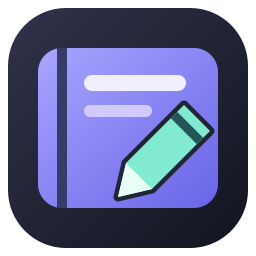
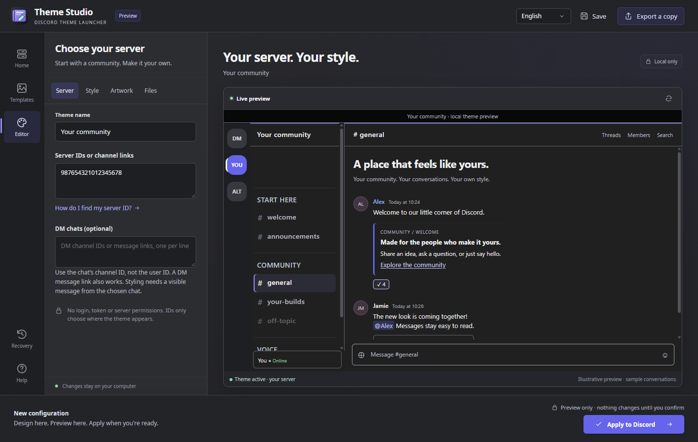

<p align="center">
  
</p>
<h1 align="center">Theme Studio</h1>
<p align="center"><strong>Create a Discord theme. Make it yours. Choose where it belongs.</strong></p>
<p align="center">
  A Windows editor for creating, previewing and sharing themes for the servers and private chats you choose.<br>
  Start from an empty template, customize a community design, or import compatible BetterDiscord CSS.
</p>
<p align="center">
  <a href="https://github.com/PrimeBuild-pc/discord-theme-launcher/releases/tag/v0.3.0-beta.12"></a>
  <a href="https://github.com/PrimeBuild-pc/discord-theme-launcher/actions/workflows/check.yml"></a>
  
  <a href="LICENSE"></a>
</p>
<p align="center">
  <a href="https://github.com/PrimeBuild-pc/discord-theme-launcher/releases/tag/v0.3.0-beta.12"><strong>Download beta.12</strong></a>
  &nbsp;·&nbsp; <a href="docs/INSTALLATION.md">Installation</a>
  &nbsp;·&nbsp; <a href="#contributing">Contribute</a>
  &nbsp;·&nbsp; <a href="https://github.com/PrimeBuild-pc/discord-theme-launcher/issues">Report an issue</a>
</p>
<p align="center">
  
  <br><sub>Local editing and an illustrative preview. Theme application requires your confirmation.</sub>
</p>

<h2 id="why-theme-studio">Your theme, your chosen conversations</h2>

Theme Studio brings **creation, editing, preview, targeting, sharing and recovery** into one desktop app. Use [BetterDiscord's theme gallery](https://betterdiscord.app/themes) to find a design, download its CSS, then import and review it in the editor.

<table>
  <tr>
    <td width="33%" valign="top"><strong>Create &amp; customize</strong><br>Three-color palettes, reusable artwork, 64 fonts on demand and custom font import. Save named themes, palettes and images locally.</td>
    <td width="33%" valign="top"><strong>Preview &amp; target</strong><br>Edit beside a live preview. Apply one theme to your selected servers and specific DM chats, with up to 16 targets of each kind.</td>
    <td width="33%" valign="top"><strong>Share &amp; restore</strong><br>Export portable themes with their assets. Review every application and restore earlier setups from local recovery snapshots.</td>
  </tr>
</table>

**Themes affect your local client.** Other members install shared themes themselves. No Discord login, token, bot or server permissions are required.

<h2 id="get-started">Get started</h2>

1. Download the **Windows x64 portable ZIP** from the [beta.12 release](https://github.com/PrimeBuild-pc/discord-theme-launcher/releases/tag/v0.3.0-beta.12), extract it and run `DiscordThemeLauncher.exe` without Administrator privileges.
2. Open **Templates** and choose an empty or community template, or import a downloaded `.theme.css` / `.dtheme` file in **Editor → Files**. Folder import is also available.
3. In **Editor**, set your targets, colors, typography and artwork. **Save theme** keeps the design in **My themes**; **Save a new copy…** keeps a separate variation.
4. Choose **Review & apply**, review the current theme and all its targets, finish calls or streams, then confirm. Discord restarts during application.

**Requirements:** Windows x64, the standard per-user stable Discord installation, and [Microsoft Edge WebView2 Runtime](https://developer.microsoft.com/microsoft-edge/webview2/). Vencord is required for themes; setup and recognized broken-install repair are described in the [installation guide](docs/INSTALLATION.md). The app bundles .NET, so no separate .NET installation is needed. The executable is currently **unsigned**.

<h2 id="inside-the-editor">Inside the editor</h2>

| Section | What you can do |
| --- | --- |
| **Servers / DMs** | Set the theme name and optional description. Enter server IDs/channel links and optional DM channel IDs/message links. |
| **Style** | Customize supported design options, save named three-color palettes, and choose or import fonts. Imported CSS exposes its supported variables. |
| **Artwork** | Import banners/backgrounds, see actual image thumbnails, and reuse images from your local library. |
| **Files** | Import files or folders, save local profiles, export portable copies, and propose a community theme. |

Saved items show a **✓ Saved** check; save buttons reactivate when there are changes. Closing with pending edits offers **Save and close**, **Discard**, or **Keep editing**. Reopening resumes the last clean document and selected section.

To reuse a design, choose **Home → Use a saved theme → Open in editor** (also under **Templates → My themes**). Make a small change or add another server on a new line, keeping the existing IDs. Choose **Save theme**, then **Review & apply**. Applying uses the complete current target list; it replaces the active personal theme rather than adding another active design. **Duplicate theme…** creates an independent saved copy without replacing your open draft.

A `.dtheme` export includes the selected assets, font license and preserved imported source, so the recipient can reopen and customize it. Saving stays local and does not restart Discord. Save before choosing a target if you are still designing.

<details>
<summary><strong>Fonts, artwork and local storage</strong></summary>

- **64 additional font families** are searchable and downloaded only when selected. Downloads are hash-verified and cached; selected fonts and licenses travel with the exported theme. Display headings/channels change while messages keep native typography. [Font catalog](docs/FONT-CATALOG.md).
- **PNG/JPEG artwork** is normalized and embedded. Imported images stay usable if their original files move. Static TTF/OTF import remains available with a redistribution license. [Format and limits](docs/CONFIGURATIONS.md).
- Themes, palettes and images live under `%LOCALAPPDATA%\PrimeBuild\DiscordThemeLauncher\library`. Session state and recovery snapshots are stored beside that library. Upgrading the portable app preserves these local files.

</details>

English, Italian, Spanish, Russian and **German** are supported. The illustrative preview follows the chosen language; author names and user-created content remain as written.

<h2 id="templates">Included templates</h2>

| Template | Author | Starting point |
| --- | --- | --- |
| **Empty template** | Theme Studio | Neutral Fluent Dark for a new design. |
| **Prime Build** | [PrimeBuild-pc](https://github.com/PrimeBuild-pc) | Hardware-inspired colors, artwork and typography. |
| **Prime Build Dev** | [PrimeBuild-pc](https://github.com/PrimeBuild-pc) | Developer-inspired colors, artwork and typography. |
| **FantaFort** | [PrimeBuild-pc](https://github.com/PrimeBuild-pc) | Arena-inspired colors, artwork and typography. |
| **Zenit Gold — by JACKPOT71** | [JACKPOT71](https://github.com/JACKPOT71) · [original theme](https://github.com/JACKPOT71/zenit-gold) | Original gold design with a reviewed, offline, target-scoped adaptation. |

Zenit Gold retains its author's MIT notice, original artwork and offline Montserrat font. Source version and adaptation details are recorded in [the import documentation](docs/BETTERDISCORD-IMPORT.md).

<h2 id="compatibility-and-recovery">Compatibility &amp; recovery</h2>

- **BetterDiscord import is a supported subset.** The app reviews a file before accepting it and reports unsupported rules or resources. Arbitrary remote resources are not fetched for preview. Not every gallery theme can be imported. [Import compatibility](docs/BETTERDISCORD-IMPORT.md).
- **Apply uses the current document's targets only.** It replaces the single personal-theme slot and disables other launcher presets, preserving their files. External themes remain enabled and can still affect appearance.
- **DM themes require visible message markers.** Empty chats or an incompatible Discord layout keep the theme off. The app does not fetch private messages. [Server and DM targeting](docs/TARGETS.md).
- **Recovery keeps files and plugins.** Disable launcher themes only, disable all styling including external themes and QuickCSS, or restore a previous setup. Each operation saves a recovery snapshot. [Recovery guide](docs/INSTALLATION.md#restore-previous-setup).

Automatic setup supports stable Discord and the default Vencord profile. Store/PTB/Canary, custom profiles and other operating systems are outside automatic support. Discord updates can change theme selectors. See [compatibility](docs/COMPATIBILITY.md) and [tested coverage and remaining limits](docs/THEME-STUDIO-VALIDATION.md).

<h2 id="contributing">Contributing</h2>

**Report a bug:** [open an issue](https://github.com/PrimeBuild-pc/discord-theme-launcher/issues) with the app version, Windows/Discord variant, reproduction steps and expected behavior. Use synthetic conversations in screenshots and omit account data.

**Propose a theme:** export your `.dtheme`, attach it as a ZIP to the [theme submission form](https://github.com/PrimeBuild-pc/discord-theme-launcher/issues/new?template=theme_submission.yml), and include a preview, author/source and redistribution license. **Propose a theme** in the app opens this same process. A maintainer reviews inclusion; the app does not upload files or create a PR automatically.

**Contribute code:** open a focused PR with the behavior change and relevant validation. Use synthetic fixtures and isolated test profiles; do not commit real Discord messages, user theme libraries or credentials.

<h3>Build and test</h3>

Use **Node.js 22+**, the **.NET 10 SDK** and the pinned npm dependencies. Windows is required for native integration and packaging.

```sh
npm ci
npx playwright install chromium
npm run verify
```

On Windows:

```powershell
dotnet run --project launcher/WindowsTests/WindowsTests.csproj -c Release
./scripts/package-windows.ps1
```

`npm run verify` regenerates the themes and runs CSS/resource audits, JavaScript checks, Core tests and Chromium tests. Windows integration exercises the real WebView2 host. Packaging writes the executable, portable ZIP, standalone preset CSS, catalog, licenses and release checksums under `dist/release`.

| Location | Responsibility |
| --- | --- |
| `launcher/Core` | Configuration, CSS import/compilation, local libraries and reversible theme transactions. |
| `launcher/Windows` | WinForms host, WebView2 editor and Windows/Discord integration. |
| `src` / `assets` | Theme sources, catalogs, artwork, fonts and third-party notices. |
| `tests` / `launcher/*Tests` | Synthetic browser fixtures and isolated Core/native integration tests. |
| `scripts` | Generation, validation and portable packaging. |

Edit UI copy in `launcher/Windows/ui/studio-copy.json` and `studio-de.json`, then run `npm run build`; the corresponding portion of `i18n.js` is generated. Keep generated CSS, `catalog.json` and `SHA256SUMS.txt` in sync. See [architecture](docs/ARCHITECTURE.md) for implementation boundaries and [validation](docs/THEME-STUDIO-VALIDATION.md) for test coverage.

<h2 id="license-and-credits">License &amp; credits</h2>

Theme Studio is maintained by [PrimeBuild-pc](https://github.com/PrimeBuild-pc) under the [MIT license](LICENSE). Zenit Gold is **by JACKPOT71**, with its [original MIT notice](assets/community/zenit-gold/LICENSE) retained. Bundled fonts retain their SIL OFL notices; portable packages include .NET and WebView2 SDK notices. Community assets remain subject to their own licenses.

<sub>An independent project, not affiliated with Discord, Vencord or BetterDiscord. Vencord is an unofficial client modification; its use is subject to Discord's terms. Discord fonts and Vencord binaries are not bundled.</sub>
