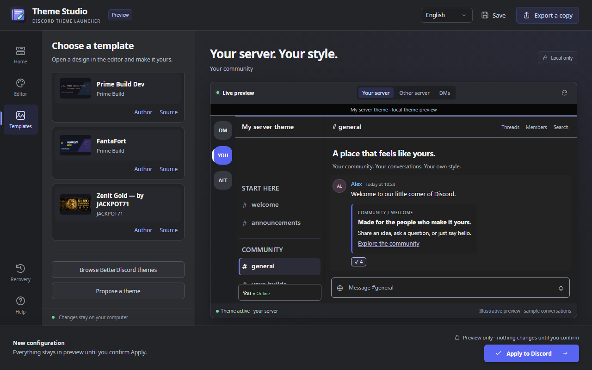

# Theme Studio · Discord Theme Launcher

Create, edit, preview and share a Discord theme for the server you choose. Start with neutral **Fluent Dark**, customize a community design, or import a compatible downloaded BetterDiscord `.theme.css`. Review it before applying and restore your previous setup when needed.

**Changes affect your local Discord client.** Other members choose whether to install a shared theme themselves. This app does not alter a server for everyone, discover membership, read messages, or request Discord credentials.

This branch prepares **0.3.0-beta.9** as a draft, not a public release. Build a portable candidate using the commands below. [Published releases](https://github.com/PrimeBuild-pc/discord-theme-launcher/releases) may predate this workflow.


## Home, Editor, Templates

1. **Home** offers three actions: create a theme, import a theme, or choose a template.
2. **Editor** keeps **Server**, **Style**, **Artwork** and **Files** together beside the live preview. Start with Fluent Dark, customize a template, or import `.dtheme` / compatible downloaded BetterDiscord `.theme.css` files. Folder import includes subfolders (up to eight levels and 100 theme files), reports incompatible files, and lets you choose a design to edit.
3. **Templates** contains Prime Build, Prime Build Dev, FantaFort and credited Zenit Gold. Choose one to customize in the editor, or [browse BetterDiscord themes](https://betterdiscord.app/themes) and import your downloaded file. Compatibility is reviewed before accepting CSS; not every BetterDiscord theme is supported.
4. **Save** keeps your editable `.dtheme`; **Export a copy** creates a portable copy with assets, licenses and original imported bytes. A target server is optional while saving. **Source and license** details remain available under Files.
5. **Apply to Discord** requires an explicit server and a valid preview. Review the theme and target, finish calls and save drafts, then confirm. Vencord setup is offered with consent only when applying requires it.
6. **Recovery → Restore Discord** opens one embedded dialog: disable launcher themes only, or all local/online themes and QuickCSS. Both preserve files and plugins and save a recovery snapshot. Alternatively select a previously applied setup from the history. Full resets also save the three styling settings needed to undo that reset; other preferences are never copied or reverted.

English, Italian, Spanish, Russian and **German** are available from the header. The synthetic preview conversation follows the selected language; theme names, source code, author credits and user-created content stay as authored. Help, discard prompts and recovery are embedded overlays in the application. Language persists for the Windows user; documentation remains English.

## Community designs

| Design | Author / source | License and capabilities |
| --- | --- | --- |
| Prime Build — Build Your Dream | [PrimeBuild-pc](https://github.com/PrimeBuild-pc/discord-theme-launcher) | MIT; palette, typography and artwork |
| Prime Build Dev — Software House | [PrimeBuild-pc](https://github.com/PrimeBuild-pc/discord-theme-launcher) | MIT; palette, typography and artwork |
| FantaFort — Arena | [PrimeBuild-pc](https://github.com/PrimeBuild-pc/discord-theme-launcher) | MIT; palette, typography and artwork |
| **Zenit Gold — by JACKPOT71** | [JACKPOT71](https://github.com/JACKPOT71) · [zenit-gold](https://github.com/JACKPOT71/zenit-gold) | MIT; original gold design, banner and mascot; supported variables; explicit server-pane adaptation |

Zenit v2.2.1 is pinned to commit `64cc7a1eaf77dc3b081d5fd0637d8dc165b273c6`. Copyright © 2026 ZENIT / Jackpot and the [original MIT license](assets/community/zenit-gold/LICENSE) are retained. Server adaptation is by Theme Studio, with author consent supplied by Lorenzo. Montserrat is bundled from pinned Google Fonts source under [SIL OFL 1.1](assets/community/zenit-gold/font/OFL.txt); preview makes no Google Fonts request.



## Compatible CSS import, with limits

This is a **supported subset**, not universal BetterDiscord compatibility. A native parser retains the imported design and confines supported rules to the chosen server pane. It handles root rules, embedded images, grouping rules, named animations and contained fixed backgrounds. It does not substitute a built-in preset.

Remote/relative resources, unknown global rules, nested CSS, unsafe document-root layouts and unsupported font/import registrations produce a report before accepting the file. No arbitrary preview resources are fetched. The pinned Zenit font import has a reviewed offline adapter. Global settings and detached portals retain their normal appearance. Obsolete third-party Discord selectors may have no effect.

CSS source is limited to 2 MiB; `.dtheme` to 24 MiB. Source and SHA-256 are retained and revalidated on reopen/apply. Original CSS export may be global when installed directly elsewhere; share `.dtheme` for the server-targeted workflow. See [the precise compatibility model and pinned provenance](docs/BETTERDISCORD-IMPORT.md).

Custom PNG/JPEG artwork is normalized to PNG, at most 8 MiB, 4096 px per side and 16 million pixels. Static TTF/OTF imports require redistribution and editable embedding rights and a license, at most 2 MiB. Do not redistribute assets without permission. Hashes detect corruption, not authorship or licensing.

## Suggest a theme

**Propose a theme** first explains the process in the app, then opens the [GitHub issue submission form](https://github.com/PrimeBuild-pc/discord-theme-launcher/issues/new?template=theme_submission.yml). Supply author/source, a synthetic-data preview, the file or pinned source, and license information. Human review precedes inclusion; submission never installs or publishes automatically.

Save a `.dtheme` copy and attach it as a ZIP with a preview, author/source and redistribution license. The user submits the issue personally with a GitHub account. The launcher does not upload files, create a pull request, send email or publish a theme automatically.

## Windows setup

The executable and taskbar window use the bundled Theme Studio icon. The portable build is self-contained .NET 10 for Windows x64. Extract its ZIP and run `DiscordThemeLauncher.exe` normally, without Administrator privileges. The UI requires **Microsoft Edge WebView2 Runtime**, never installed silently. Optional Vencord setup uses its pinned official installer.

Automatic application supports per-user stable Discord and the default Vencord profile. Store/PTB/Canary, custom profiles, unknown loaders, linked folders and other platforms are outside automatic support. The EXE is **unsigned**. No security settings are changed. This independent project is not affiliated with Discord or Vencord; Vencord is unofficial and has terms/account implications.

Read [Installation and recovery](docs/INSTALLATION.md), [Compatibility](docs/COMPATIBILITY.md), [Configuration format](docs/CONFIGURATIONS.md), and [tested/not-tested evidence](docs/THEME-STUDIO-VALIDATION.md).

## Development

Node 22+, .NET 10 SDK and pinned npm dependencies are required. Windows is required for native integration and packaging. After editing `assets/app-icon.svg`, regenerate its multi-size ICO with `node scripts/build-icon.mjs`.

```sh
npm ci
npx playwright install chromium
npm run verify
```

```powershell
dotnet run --project launcher/WindowsTests/WindowsTests.csproj -c Release
./scripts/package-windows.ps1
```

Tests use isolated profiles and synthetic conversations. Native integration and the separate agent-desktop smoke check do not cover Windows reboot behavior. No real Discord profile is modified by tests. See [architecture](docs/ARCHITECTURE.md), [acceptance progress](docs/THEME-STUDIO-PROGRESS.md), and the [credited preview for Lorenzo](docs/ZENIT-PREVIEW.md).

## Credits and licenses

Original code/artwork: [MIT](LICENSE), maintained by [PrimeBuild-pc](https://github.com/PrimeBuild-pc). Community names/logos identify their owners. Zenit retains JACKPOT71's copyright and MIT notice. Noto Sans, Rajdhani, JetBrains Mono, Bangers and Montserrat retain SIL OFL notices. Test-only Dracula source retains its [MIT license](tests/imports/dracula/LICENSE). Portable packages include .NET and WebView2 SDK notices. Discord's proprietary fonts and Vencord binaries are not bundled.
