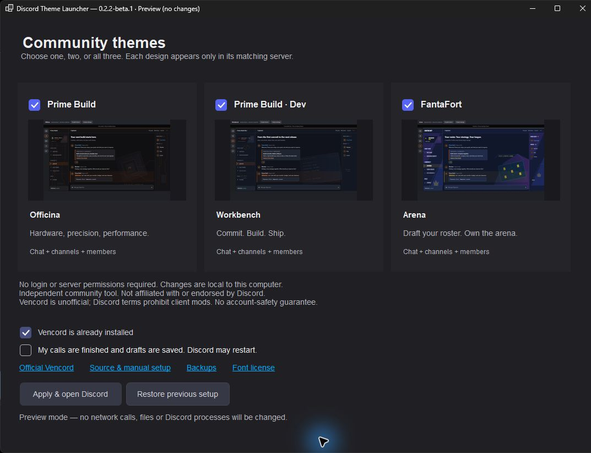

<div align="center">
  <a href="https://github.com/PrimeBuild-pc/discord-theme-launcher/releases/download/v0.2.4-beta.1/DiscordThemeLauncher-0.2.4-beta.1-windows-x64-portable.zip">
    
  </a>

  <h1>Discord Theme Launcher</h1>

  <p><strong>Three community designs. One simple Windows setup.</strong><br>Personalize Prime Build, Prime Build Dev and FantaFort with independent, server-scoped themes.</p>

  <p>
    <a href="https://github.com/PrimeBuild-pc/discord-theme-launcher/actions/workflows/check.yml"></a>
    <a href="https://github.com/PrimeBuild-pc/discord-theme-launcher/releases"></a>
    <a href="docs/COMPATIBILITY.md"></a>
    <a href="https://vencord.dev/download/"></a>
    <a href="LICENSE"></a>
  </p>

  <p>
    <a href="https://github.com/PrimeBuild-pc/discord-theme-launcher/releases/download/v0.2.4-beta.1/DiscordThemeLauncher-0.2.4-beta.1-windows-x64-portable.zip"><strong>Download for Windows</strong></a>
    &nbsp;·&nbsp; <a href="#quick-setup">Quick setup</a>
    &nbsp;·&nbsp; <a href="#three-identities">Theme gallery</a>
    &nbsp;·&nbsp; <a href="docs/INSTALLATION.md">Installation &amp; recovery</a>
    &nbsp;·&nbsp; <a href="docs/VALIDATION.md">Validation</a>
  </p>

  <p><sub>Maintained by <a href="https://github.com/PrimeBuild-pc">PrimeBuild-pc</a>. Independent community project; not affiliated with Discord or Vencord.</sub></p>
</div>

## Launcher interface

<p align="center">
  <a href="assets/launcher-preview.jpg">
    
  </a>
  <br>
  <sub>Actual Windows application, shown in non-mutating preview mode. Click to view at full size.</sub>
</p>

Choose **Prime Build**, **Prime Build Dev**, **FantaFort**, or any combination. The launcher prepares the selected themes, backs up the managed files, enables them, and reopens Discord. Each theme appears only in its matching server; other servers and global account settings remain outside its scope.

The launcher follows Discord's native dark palette and typography stack. It uses installed **gg sans** when available, otherwise embedded **Noto Sans**, also a Discord fallback. Proprietary Discord fonts are not bundled. Checkboxes, buttons and dialogs retain light, readable text in disabled states. This is an independent community tool, not an official Discord extension.

## Three identities

| Server | Design | Backgrounds and details |
| --- | --- | --- |
| Prime Build | **Build Your Dream** | Near-black and orange, processor/heatsink artwork, PCB traces, mechanical details, Rajdhani typography |
| Prime Build Dev | **Software House** | Prime Build orange with slate surfaces, code editor, terminal and commit/build references, JetBrains Mono typography |
| FantaFort | **Arena** | Deep blue, violet, cyan and yellow, angular arena panels, fantasy-roster pitch and tactics, Bangers display typography |

The server identities are not numbered. Each server has its own embedded display font: **Rajdhani** for Prime Build, **JetBrains Mono** for Prime Build Dev and **Bangers** for FantaFort. Graphic lettering, headings, channel navigation and member groups follow that identity; messages, usernames and the composer keep their existing fonts. No font installation or theme font/image downloads are required.

All three customize the **chat background, channel panel, member panel, header, common cards, reactions, composer and navigation states**. Artwork is static and embedded in the CSS. The server icon rail is not redesigned. Role/status colors and useful native controls are retained.

<details>
<summary><strong>Prime Build — Build Your Dream</strong></summary>


</details>

<details>
<summary><strong>Prime Build · Dev — Software House</strong></summary>


</details>

<details>
<summary><strong>FantaFort — Arena</strong></summary>


</details>

*These previews use the distributed CSS with synthetic content. They are sanitized test fixtures, not community-message screenshots. Actual desktop checks are reported separately.*

## Quick setup

1. Download and **extract the portable ZIP**. Run `DiscordThemeLauncher.exe` normally, without Administrator privileges.
2. Select the communities you want to personalize.
3. If Vencord is missing, explicitly choose **Install official Vencord if it is missing**. The launcher downloads and verifies the official installer for the supported setup.
4. Finish calls/streams, save drafts, and tick the restart checkbox.
5. Click **Apply & open Discord**.

The ZIP includes all three small theme files so existing Vencord users can apply their selection offline. The [standalone launcher EXE](https://github.com/PrimeBuild-pc/discord-theme-launcher/releases/download/v0.2.4-beta.1/DiscordThemeLauncher-0.2.4-beta.1-windows-x64.exe) downloads selected files from its exact release when they are not beside the executable. Both routes check file sizes and SHA-256 hashes embedded in that launcher version.

**Unchecked managed themes are removed.** Other themes, plugins, QuickCSS and unrelated settings are preserved. To remove these designs, deselect all three and apply. To undo an operation, choose **Restore previous setup**. A safety snapshot is retained before restoration too.

This beta targets **Windows x64**, standard per-user **stable Discord**, and the default Vencord profile. The launcher bundles .NET, needs no separate runtime, runs only during setup, and adds no service or auto-start task. The ZIP is approximately 45 MiB. No Discord login, token, bot, Nitro, server boost, server permissions, or membership detection is involved. You must already belong to a server to view it.

## Scope and safety

- Prime Build: `1206415718728601600`.
- Prime Build Dev: `1537861795090268302`.
- FantaFort: `1536382143796748389`.
- Every CSS file has its own selected-server guard. They can be enabled together without competing on the same server.
- Global settings, billing/security pages, external portals and unsupported detached views keep their stock appearance.
- The launcher does not join servers, read messages, alter channels/permissions, or send anything to community members.
- Only the three known theme filenames and their `enabledThemes` entries are managed. Backups store those files and their prior enabled states, not your full settings or credentials.
- Vencord installation is a separate upstream operation. Its official installer modifies the standard stable client. Theme restoration does not uninstall Vencord.

Use [Compatibility](docs/COMPATIBILITY.md) for coverage and [Installation](docs/INSTALLATION.md) for defaults, unsupported setups, backups and manual recovery. The launcher refuses elevation, linked profile paths and an obvious unknown client loader; custom installations require the manual route.

The executable is **unsigned**. Windows may display a security prompt; review source and release checksums before deciding whether to run it. No security protection is disabled. SHA-256 is an integrity check, not a publisher signature.

Vencord is an unofficial client modification and [its support page notes the Discord terms implications](https://vencord.dev/support/). Reversible styling does not guarantee account safety. This project is not affiliated with Discord or Vencord. FantaFort is independent and is not endorsed by or affiliated with Epic Games; its theme uses original generic arena/fantasy artwork, not Fortnite game assets.

## Manual installation

Download only the `.theme.css` files you want from the release, copy them into **User Settings > Vencord > Themes > Open Themes Folder**, and enable them. No launcher or build tools are required for this route. See [Installation and removal](docs/INSTALLATION.md).

Existing Officina users can keep their current installation or replace `PrimeBuild.theme.css` through the launcher. The repository was renamed from `primebuild-discord-theme`; GitHub redirects its former URL. The original 0.1 beta remains a historical release.

## Development

Themes: Node 22+ and the pinned npm development dependencies. Launcher: .NET 10 SDK; Windows is needed for the native UI and packaging.

```sh
npm ci
npx playwright install chromium
npm run verify
dotnet run --project launcher/Tests/Tests.csproj -c Release -- .
```

On Windows, run `./scripts/package-windows.ps1` in PowerShell 7 to build the self-contained x64 executable and portable ZIP. CI checks the generated themes, runs browser and installer-core tests, and produces a Windows release artifact. See [Architecture](docs/ARCHITECTURE.md) and [Validation](docs/VALIDATION.md).

## Maintainer and license

[Prime Build](https://primebuild.website/) | [FantaFort](https://fantafort.com/) | [Issues](https://github.com/PrimeBuild-pc/discord-theme-launcher/issues)

Original code and new vector artwork are provided under [MIT](LICENSE). Prime Build and FantaFort names identify the communities; the license does not imply their endorsement of modified versions. Prime Build logo source: [primebuild.website](https://primebuild.website/). No Zenit Gold code or artwork is included. The portable package includes notices for its bundled .NET runtime and [Noto Sans](assets/fonts/OFL.txt), [Bangers](assets/fonts/bangers/OFL.txt), [Rajdhani](assets/fonts/rajdhani/OFL.txt) and [JetBrains Mono](assets/fonts/jetbrains-mono/OFL.txt), all under SIL OFL 1.1. Bangers is an independent display face, not the proprietary Fortnite font. Vencord is downloaded from its official project, not bundled or relicensed here.
